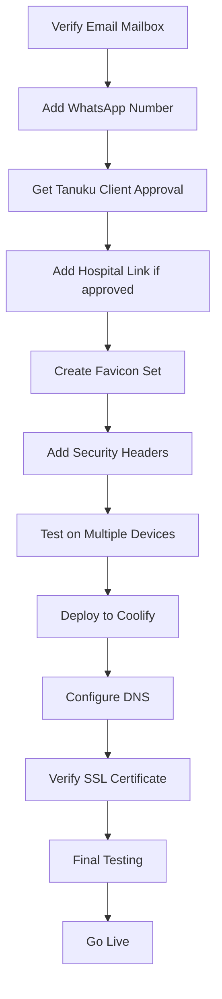

# Vihsm Website Completion & Improvement Plan

## Executive Summary

The Vihsm portfolio website is **functionally complete** with professional design, responsive layout, and Docker deployment setup. However, it requires **configuration** and has opportunities for **enhancement** before launch.

---

## Current State Analysis

### ✅ What's Complete

1. **HTML Structure** ([`index.html`](../index.html))
   - Semantic HTML5 markup
   - All sections implemented: Hero, APIs, Apps, Websites, Hosting, Contact
   - Proper meta tags for SEO and Open Graph
   - Accessible navigation with ARIA labels
   - 6 API products documented
   - 3 app products documented
   - Pricing structure for website services

2. **Styling** ([`styles.css`](../styles.css))
   - Custom CSS with CSS variables for theming
   - Responsive design with mobile breakpoint (@800px)
   - Professional color scheme (warm paper tones)
   - Typography using Google Fonts (Newsreader serif + Outfit sans)
   - Card-based layout with shadows
   - Smooth scroll behavior
   - Sticky header with backdrop blur

3. **JavaScript** ([`site.js`](../site.js))
   - Dynamic email link configuration
   - WhatsApp link with pre-filled message
   - Conditional display logic (hides WhatsApp if no number)

4. **Deployment** ([`Dockerfile`](../Dockerfile), [`nginx.conf`](../nginx.conf))
   - Nginx-based Docker container
   - Optimized Alpine Linux image
   - Ready for Coolify deployment
   - Port 80 configuration

---

## ⚠️ Pre-Launch Requirements (from README)

### Critical Configuration Tasks

1. **Email Setup**
   - Status: ✅ Configured as `hello@vihsmai.com`
   - Action: Verify mailbox exists and is monitored

2. **WhatsApp Number**
   - Status: ❌ Empty string in [`site.js`](../site.js:4)
   - Action: Add number in format `91XXXXXXXXXX` (country code + number)
   - Impact: WhatsApp button currently hidden from users

3. **Tanuku Hospital Link**
   - Status: ⚠️ Mentioned in text but no live link
   - Location: [`index.html`](../index.html:132) line 132
   - Action: Add link only after written client approval
   - Current text: "The live link is shared when that client has agreed."

---

## 🎯 Identified Improvements

### High Priority

#### 1. **Missing Favicon**
- Current: Data URI SVG favicon (basic "V" letter)
- Recommendation: Create proper favicon set
  - `favicon.ico` (16x16, 32x32)
  - `apple-touch-icon.png` (180x180)
  - `favicon-192.png` and `favicon-512.png` for PWA
  - Update HTML `<link>` tags

#### 2. **SEO Enhancements**
- Add `robots.txt` file
- Add `sitemap.xml` for search engines
- Consider adding structured data (JSON-LD) for:
  - Organization schema
  - LocalBusiness schema (Hyderabad location)
  - Service offerings

#### 3. **Performance Optimization**
- Add `loading="lazy"` for images (when images are added)
- Consider adding `rel="preload"` for critical fonts
- Minify CSS and JS for production
- Add cache headers in nginx.conf

#### 4. **Analytics & Monitoring**
- No analytics tracking currently
- Consider adding:
  - Google Analytics or privacy-focused alternative (Plausible, Umami)
  - Error tracking (Sentry)
  - Uptime monitoring integration

#### 5. **Security Headers**
- Add security headers to [`nginx.conf`](../nginx.conf):
  - `X-Frame-Options`
  - `X-Content-Type-Options`
  - `Referrer-Policy`
  - `Permissions-Policy`
  - Content Security Policy (CSP)

### Medium Priority

#### 6. **Accessibility Improvements**
- Add skip-to-content link
- Ensure all interactive elements have focus states
- Add `lang` attributes where content switches languages
- Test with screen readers

#### 7. **Content Enhancements**
- Add actual client testimonials (if available)
- Add case study section for Tanuku hospital (post-approval)
- Consider adding a blog/updates section
- Add team/about section with founder info

#### 8. **Interactive Features**
- Add contact form (currently email-only)
- Add newsletter signup
- Add live chat widget option
- Consider adding a simple CMS for content updates

#### 9. **Visual Assets**
- Add product screenshots/mockups for APIs and apps
- Add photos of team or office (Hyderabad)
- Add client logos (with permission)
- Consider adding illustrations or icons

### Low Priority

#### 10. **Progressive Web App (PWA)**
- Add `manifest.json`
- Add service worker for offline capability
- Make site installable on mobile devices

#### 11. **Internationalization**
- Site mentions 10 Indian languages for apps
- Consider adding Hindi/Telugu versions of main site
- Add language switcher

#### 12. **Additional Pages**
- Privacy Policy page
- Terms of Service page
- Detailed case studies page
- FAQ page

---

## 📋 Implementation Roadmap

### Phase 1: Pre-Launch Essentials (Required before going live)



**Tasks:**
1. Verify `hello@vihsmai.com` mailbox is active
2. Add WhatsApp number to [`site.js`](../site.js)
3. Obtain written approval from Tanuku hospital client
4. Add hospital link to [`index.html`](../index.html) if approved
5. Create and add proper favicon files
6. Add security headers to [`nginx.conf`](../nginx.conf)
7. Test responsive design on mobile, tablet, desktop
8. Test in Chrome, Firefox, Safari, Edge
9. Deploy to Coolify with domain configuration
10. Verify SSL certificate for vihsmai.com and www.vihsmai.com

### Phase 2: Post-Launch Optimization (First 30 days)

**Tasks:**
1. Add `robots.txt` and `sitemap.xml`
2. Implement analytics tracking
3. Set up uptime monitoring
4. Minify CSS and JavaScript
5. Add structured data (JSON-LD)
6. Monitor performance with Lighthouse
7. Gather user feedback
8. Fix any reported issues

### Phase 3: Feature Enhancements (Ongoing)

**Tasks:**
1. Add contact form functionality
2. Add client testimonials
3. Create case study for Tanuku hospital
4. Add product screenshots
5. Implement PWA features
6. Consider multi-language support
7. Add blog/updates section
8. Expand content based on user needs

---

## 🔧 Technical Recommendations

### File Structure Enhancement

```
Portfolio_marketting/
├── index.html
├── styles.css
├── site.js
├── Dockerfile
├── nginx.conf
├── README.md
├── robots.txt                    # NEW: SEO
├── sitemap.xml                   # NEW: SEO
├── manifest.json                 # NEW: PWA
├── assets/                       # NEW: Organized assets
│   ├── images/
│   │   ├── favicon.ico
│   │   ├── apple-touch-icon.png
│   │   ├── favicon-192.png
│   │   ├── favicon-512.png
│   │   ├── products/             # Product screenshots
│   │   └── clients/              # Client logos
│   ├── fonts/                    # Self-hosted fonts (optional)
│   └── scripts/
│       └── analytics.js          # Separate analytics
└── plans/                        # Planning documents
    └── vihsm-website-completion-plan.md
```

### Nginx Configuration Enhancements

Add to [`nginx.conf`](../nginx.conf):
- Gzip compression
- Browser caching headers
- Security headers
- HTTP/2 support
- Redirect www to non-www (or vice versa)

### Environment-Specific Configuration

Create separate configs for:
- **Development**: Unminified, with source maps
- **Staging**: Production-like, with test analytics
- **Production**: Minified, optimized, real analytics

---

## 🧪 Testing Checklist

### Functional Testing
- [ ] All navigation links work
- [ ] Email link opens mail client
- [ ] WhatsApp link works (after number added)
- [ ] All external API/app links are valid
- [ ] Smooth scroll navigation functions
- [ ] Sticky header works on scroll

### Responsive Testing
- [ ] Mobile (320px - 480px)
- [ ] Tablet (481px - 800px)
- [ ] Desktop (801px+)
- [ ] Large screens (1920px+)

### Browser Testing
- [ ] Chrome/Edge (Chromium)
- [ ] Firefox
- [ ] Safari (macOS/iOS)
- [ ] Mobile browsers (Chrome, Safari)

### Performance Testing
- [ ] Lighthouse score > 90
- [ ] First Contentful Paint < 1.5s
- [ ] Time to Interactive < 3s
- [ ] No console errors
- [ ] All fonts load properly

### SEO Testing
- [ ] Meta tags present
- [ ] Open Graph tags work
- [ ] Canonical URL set
- [ ] Heading hierarchy correct (H1 → H2 → H3)
- [ ] Alt text for images (when added)

### Accessibility Testing
- [ ] Keyboard navigation works
- [ ] Screen reader compatible
- [ ] Color contrast meets WCAG AA
- [ ] Focus indicators visible
- [ ] ARIA labels appropriate

---

## 🚀 Deployment Strategy

### Coolify Deployment Steps

1. **Repository Setup**
   - Ensure repo is accessible to Coolify
   - Verify Dockerfile builds successfully locally

2. **Coolify Configuration**
   - Create new application
   - Select Dockerfile build
   - Set port to 80
   - Configure environment variables (if needed)

3. **Domain Configuration**
   - Attach `vihsmai.com`
   - Attach `www.vihsmai.com`
   - Configure DNS A/CNAME records
   - Enable automatic SSL (Let's Encrypt)

4. **Build & Deploy**
   - Trigger initial build
   - Monitor build logs
   - Verify deployment success

5. **Post-Deployment**
   - Test all functionality
   - Verify SSL certificate
   - Check DNS propagation
   - Monitor server logs

### Rollback Plan

- Keep previous version tagged in Git
- Document rollback procedure in Coolify
- Maintain backup of DNS settings
- Have emergency contact for hosting issues

---

## 📊 Success Metrics

### Launch Metrics
- Site loads in < 2 seconds
- Mobile-friendly test passes
- SSL certificate valid
- All links functional
- Zero console errors

### Post-Launch KPIs (30 days)
- Uptime > 99.9%
- Average page load < 2s
- Bounce rate < 60%
- Contact form submissions (if added)
- WhatsApp inquiries

---

## 🎨 Design Quality Assessment

### Strengths
- ✅ Professional, clean design
- ✅ Consistent color scheme
- ✅ Good typography hierarchy
- ✅ Effective use of white space
- ✅ Clear call-to-action buttons
- ✅ Well-organized content sections

### Areas for Enhancement
- 🔄 Add visual assets (screenshots, photos)
- 🔄 Consider adding subtle animations
- 🔄 Add loading states for dynamic content
- 🔄 Enhance card hover effects

---

## 💡 Content Strategy Recommendations

### Current Content Strengths
- Clear value proposition
- Specific service offerings
- Transparent pricing
- Appropriate disclaimers for health/financial tools
- Local focus (Hyderabad, AP, Telangana)

### Content Gaps
- No client testimonials
- No case studies (pending Tanuku approval)
- No team/founder information
- No blog or thought leadership content
- Limited social proof

### Content Additions to Consider
1. **About/Team Section**: Add founder story, team expertise
2. **Case Studies**: Detailed client success stories
3. **Blog**: Technical articles, industry insights
4. **FAQ**: Common questions about services
5. **Resources**: Guides, whitepapers, documentation

---

## 🔐 Security Considerations

### Current Security
- ✅ HTTPS ready (via Coolify SSL)
- ✅ No sensitive data in frontend
- ✅ No user authentication (static site)

### Recommended Additions
- Add security headers in nginx
- Implement Content Security Policy
- Regular dependency updates (nginx image)
- Monitor for vulnerabilities
- Add rate limiting for contact form (when added)

---

## 📝 Documentation Needs

### For Development Team
- [ ] Component documentation
- [ ] Deployment runbook
- [ ] Troubleshooting guide
- [ ] Content update procedures

### For Business Team
- [ ] Content management guide
- [ ] Brand guidelines
- [ ] SEO best practices
- [ ] Analytics interpretation guide

---

## Next Steps

1. **Immediate Actions** (This week)
   - Confirm WhatsApp number and add to [`site.js`](../site.js)
   - Verify email mailbox is operational
   - Create favicon set
   - Add security headers to nginx

2. **Short-term** (Next 2 weeks)
   - Complete all Phase 1 tasks
   - Deploy to staging environment
   - Conduct thorough testing
   - Prepare for production launch

3. **Medium-term** (First month post-launch)
   - Implement Phase 2 optimizations
   - Gather user feedback
   - Monitor analytics
   - Plan Phase 3 enhancements

4. **Long-term** (Ongoing)
   - Regular content updates
   - Feature enhancements based on user needs
   - Performance monitoring and optimization
   - SEO improvements based on data

---

## Conclusion

The Vihsm website is **production-ready** from a technical standpoint. The core functionality, design, and deployment infrastructure are solid. The main blockers to launch are:

1. **Configuration**: WhatsApp number
2. **Verification**: Email mailbox operational
3. **Client approval**: Tanuku hospital link (optional)

Once these are addressed, the site can go live. Post-launch improvements should focus on SEO, performance optimization, and content enrichment to drive business goals.

**Recommendation**: Proceed with Phase 1 tasks immediately to prepare for launch within 1-2 weeks.
